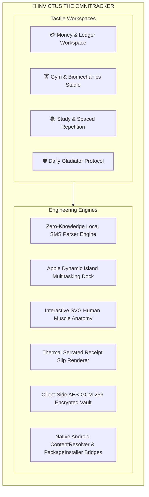
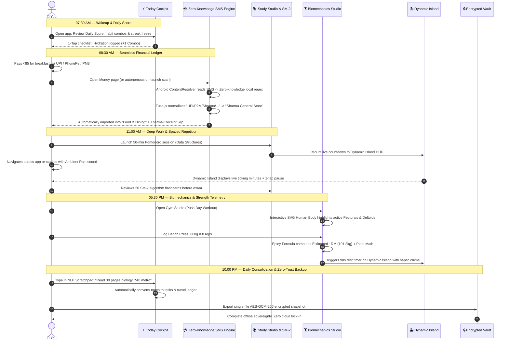
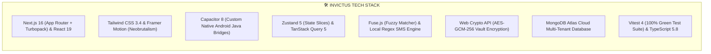
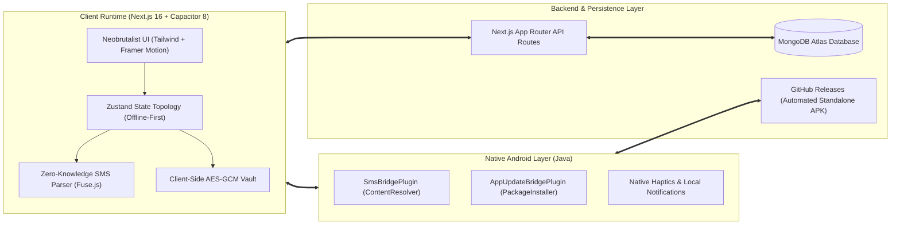

# 👑 INVICTUS: The OmniTracker OS
### *The Autonomous Life & Productivity Operating System for Relentless Execution*

[-CEF431?style=for-the-badge&logo=android&logoColor=161514&labelColor=161514)](https://github.com/LuckyJadhav2808/Invictus-The-OmniTracker/releases/tag/v1.7.8)
[-03D26F?style=for-the-badge&logo=vitest&logoColor=161514&labelColor=161514)](https://github.com/LuckyJadhav2808/Invictus-The-OmniTracker)
[-FAF8F5?style=for-the-badge&logo=next.js&logoColor=161514&labelColor=161514)](https://nextjs.org)
[-3880FF?style=for-the-badge&logo=capacitor&logoColor=white&labelColor=161514)](https://capacitorjs.com)
[](https://www.typescriptlang.org)
[](LICENSE)

---

## ⚡ The Vision: Why Invictus Exists

Most productivity seekers juggle 5 to 6 disconnected, fragmented apps every day:
- An **expense tracker** that either requires giving away banking passwords to cloud aggregators or demands tedious manual typing.
- A **gym workout tracker** locked behind expensive recurring paywalls with zero integration into daily nutrition or recovery.
- A **study/Pomodoro timer** that loses all state the moment you switch tabs or take a phone call.
- A **habit tracker** that fails the second you lose Wi-Fi on a campus or subway.

**Invictus** solves this fragmentation. It is an uncompromising, tactile, offline-first personal operating system that integrates **Finance & Ledger, Biomechanics & Gym Studio, Academic Study Engine, and Daily Discipline Protocols** into a single, cohesive Neobrutalist cockpit.

---

## 🏆 Production Benchmark Comparison

How Invictus compares against world-class category benchmarks:

| Capability | Generic Productivity Apps | Category Benchmark (Apple / Hevy / Linear) | **Invictus Engineering Standard** |
| :--- | :--- | :--- | :--- |
| **Financial Privacy** | Cloud scraping, third-party aggregators | Apple Wallet / Local Ledger | **Zero-Knowledge Local SMS Engine**: 100% on-device regex parsing; zero financial data sent to any cloud server. |
| **Merchant Resolution** | Exact raw string matching | Stripe / Plaid normalization | **Fuzzy Fuse.js + Self-Learning Dictionary**: Cleans messy UPI strings (`UPI/P2M/Swiggy/...`) into pristine merchant names with auto-category provisioning. |
| **Biomechanics** | Static text dropdown lists | Hevy / Strong interactive UI | **Interactive SVG Muscle Anatomy**: Real-time front/back muscle heatmaps, 1RM estimations, fatigue curves, and plate math. |
| **Multitasking** | Timer unmounts on navigation | iOS Dynamic Island | **Global Dynamic Island Activity Dock**: Viewport-pinned multitasking HUD for gym rest timers, Pomodoro focus, and stopwatch. |
| **Design & Motion** | Generic SaaS templates | Linear / Raycast physical feel | **Tactile Neobrutalism**: `#FAF8F5` cream surfaces, `#161514` obsidian ink borders, zero-blur hard drop shadows, and Emil Kowalski hardware-accelerated motion rules. |
| **Offline Resilience** | Blank screens & infinite spinners | Things 3 SQLite offline sync | **Zero-Trust Offline Vault**: Client-side AES-GCM-256 snapshots, Zustand state slices, and optimistic MongoDB Atlas sync. |
| **Native Distribution** | Web-only or Play Store locked | Native Android standalone APK | **Custom Native Android Bridge**: Direct ContentResolver SMS reading, native runtime permissions, and in-app APK installer with downgrade rollback defense. |

---

## 🌟 Standout Flagship Features



### 1. 💳 Zero-Knowledge On-Device SMS Bank Engine
- **100% Client-Side Privacy**: Runs locally in JavaScript/TypeScript inside the webview and native Android bridge. Banking SMS never leave your device.
- **Telecom Prefix Stripping**: Automatically normalizes carrier circle prefixes (`+91AD-PNBSMS` -> `AD-PNBSMS`) common across Indian telecoms (Airtel, Jio, Vi).
- **Comprehensive Institution Support**: Native pattern matching for Punjab National Bank (PNB), State Bank of India (SBI), HDFC Bank, ICICI Bank, Axis Bank, Kotak Mahindra, Bank of Baroda, Union Bank, DBS, Canara Bank, and FinTech handles (PhonePe, Google Pay, BHIM/NPCI UPI, OneCard, Jupiter, Fi Money, Slice).
- **Fuzzy Merchant Normalization (Fuse.js)**: Automatically resolves chaotic raw SMS tokens (e.g. `UPI/P2M/ZEPTO/zepto@hdfcbank`) to clean merchant entities (`Zepto`) and provisions categories automatically.
- **Self-Learning Merchant Dictionary**: Remembers your custom merchant edits and auto-categorizes future recurring payments instantly.
- **Autonomous On-Launch Sync**: Scans today's and yesterday's transactions on app open with a 12-hour forward buffer against carrier clock skew and IST timezone safety.
- **Thermal Jagged Receipt Slips**: Tap any expense to render an authentic retro thermal receipt with SVG serrated tear-offs, fold crease, split-bill roommate math, and barcode telemetry.

### 2. 🏋️ Interactive Human Muscle Anatomy & Biomechanics Studio
- **Vector Muscle Heatmaps**: Anatomically precise front and back SVG human bodies highlighting active muscle groups (Chest, Deltoids, Lats, Trapezius, Biceps, Triceps, Abs, Quads, Hamstrings, Glutes, Calves) in real time.
- **Set & Rep Telemetry**: Live set logging, RPE (Rate of Perceived Exertion) tracking, automatic 1RM (One Rep Max) calculation (Epley formula), and barbell plate math calculator.
- **Live Rest Timer with Dynamic Island Sync**: Automatically launches rest periods upon set completion, pinning the countdown directly to the top Dynamic Island dock.

### 3. 🏝️ Apple-Style Dynamic Island Activity Dock
- **Persistent Viewport Multitasking**: Never lose track of a rest timer or focus interval when navigating between pages.
- **Micro-State Morphing**: Smoothly expands and collapses with spring physics (`framer-motion`), providing 1-tap pause, skip, and reset controls for gym rest timers, Pomodoro focus sessions, and stopwatch telemetry.

### 4. 📚 Study Studio & Spaced Repetition (SM-2 Algorithm)
- **Spaced Repetition Flashcards**: Powered by the proven SuperMemo SM-2 algorithm to optimize memory retention intervals for exams and technical topics.
- **Pomodoro Deep Focus**: Built-in soundscapes (White Noise, Rain, Cafe, Binaural Beats) with focus analytics, session logging, and syllabus completion velocity.

### 5. 🛡️ Daily Gladiator Protocol & Habit Combos
- **Streak Freeze Protection**: Earn and spend Streak Freeze tokens to protect streaks during exam weeks or travel.
- **Habit Combo Multipliers**: Visual combos and sound feedback for chaining morning routines, workouts, and hydration logs.
- **NLP Scratchpad**: Jot down bullet points in plain text; Invictus parses expenses, habits, and tasks into structured database records automatically.

### 6. 📱 Native Android Architecture & Standalone Distribution
- **Capacitor 8 Android Runtime**: Bridges modern Next.js web application with native Android system capabilities.
- **Custom Native Java Bridges**:
  - `SmsBridgePlugin.java`: Direct access to `content://sms/inbox` using Android's native `ContentResolver` with standard Android system runtime permission flow (`READ_SMS` / `RECEIVE_SMS`).
  - `AppUpdateBridgePlugin.java`: In-app APK updater that downloads releases directly from GitHub, performs pre-flight bytecode and version inspection, and executes installation with downgrade rollback defense.
- **Zero Google Play Dependency**: Completely free from third-party app store gatekeeping.

### 7. 🔒 Zero-Trust Encrypted Data Vault
- **AES-GCM-256 Snapshots**: Export full workspace backups encrypted with your personal passphrase directly on the client side using Web Crypto API.
- **Offline-First Resilience**: State is stored in Zustand with local storage persistence and optimistic background synchronization with MongoDB Atlas.

---

## 🗺️ The Core User Journey: 24 Hours with Invictus

Here is how an ambitious student or high-performer moves through a high-output day using Invictus as their personal operating system:



### 🕒 The 5 Daily Touchpoints in Detail

1. **🌅 07:30 AM — The Morning Calibration**:
   You launch Invictus. The **Today Dashboard** renders in `<100ms` completely offline from local cache. You see your **Daily Score**, active habit combos, and streak freeze token count. One tap logs morning hydration, triggering an energetic haptic chime and incrementing your combo multiplier.

2. **☕ 08:30 AM — Frictionless Expense Ledger**:
   You pay ₹85 for breakfast at a local cafe using PhonePe UPI. In the background or upon opening the Money workspace, the **Zero-Knowledge SMS Parser** detects the carrier transaction. It strips the carrier circle prefix (`+91`), parses the account mask and amount, uses **Fuse.js** to normalize the merchant handle to `"Sharma General Store"`, provisions the `"Food & Dining"` category, and stamps a retro **Thermal Jagged Receipt Slip** with exact timestamp telemetry. Zero manual data entry.

3. **🎯 11:00 AM — Deep Focus & Exam Readiness**:
   You transition into academic work. In **Study Studio**, you set a 50-minute Pomodoro timer with soothing Rain soundscapes. The timer seamlessly mounts to the **Dynamic Island** at the top of your screen. You navigate between study topics or check your syllabus velocity; the countdown ticks persistently without unmounting. Before ending your block, you run a 15-minute flashcard drill powered by the **SuperMemo SM-2** spaced repetition algorithm.

4. **⚡ 05:30 PM — Biomechanics & Gym Studio**:
   Time for strength training. You open the **Gym Studio** for Push Day. The **Interactive SVG Muscle Anatomy** model lights up your Pectorals, Anterior Deltoids, and Triceps. You log a top set of Bench Press (80kg × 8 reps). The system immediately calculates your estimated One Rep Max (101.3kg), logs the volume, and activates a 90-second rest timer in the **Dynamic Island** with live remaining seconds.

5. **🌙 10:00 PM — Evening NLP Scratchpad & Vault Lockdown**:
   Before bed, you jot down quick unstructured thoughts in the **NLP Scratchpad**: *"Read 30 pages biology #study, ₹40 metro #travel"*. Invictus parses the bullet points, creating a study log and an expense automatically. Finally, you open Data & Vault and tap **Export Vault**: the entire workspace is encrypted client-side using **AES-GCM-256** and saved as a portable snapshot. Your life, your data, completely sovereign.

---

## 🎨 Design Philosophy: Neobrutalism & Emil Kowalski Motion

Invictus rejects sterile, generic SaaS templates in favor of a visceral, tactile, industrial aesthetic:

## 🎨 Color Palette & Neobrutalist Theme System

Invictus rejects sterile, generic SaaS templates in favor of a visceral, tactile, industrial Neobrutalist aesthetic inspired by Swiss poster design, mechanical instrument panels, and vintage hardware consoles:

### 🎨 The Core Color Palette Tokens

| Token | Hex Code | Role & Usage Across Cockpit | Visual Swatch |
| :--- | :--- | :--- | :--- |
| **Warm Cream Surface** | `#FAF8F5` | Primary application canvas and card surfaces; eases eye fatigue during extended daily use | `[ #FAF8F5 ]` |
| **Obsidian Ink** | `#161514` | High-contrast structural boundaries, 2.5px solid borders, typography, and hard drop shadows | `[ #161514 ]` |
| **Electric Lime** | `#CEF431` | Primary brand accent, hero badges, quick-action callouts, and 1-tap download triggers | `[ #CEF431 ]` |
| **Malachite Emerald** | `#03D26F` | Positive cashflow inflows, completed habits, 100% test passes, and milestone achievements | `[ #03D26F ]` |
| **Soft Amber / Gold** | `#FEF08A` | Streak freeze tokens, active warnings, countdown alerts, and AI Routine insights | `[ #FEF08A ]` |
| **Lavender / Focus Purple**| `#C084FC` | Study Studio focus sessions, Pomodoro intervals, and academic exam telemetry | `[ #C084FC ]` |
| **Crimson Coral** | `#EF4444` | Expense outflows, debt balances, missed goals, and high-consequence deletion modals | `[ #EF4444 ]` |

### 🪨 Tactile Neobrutalism & Mechanical Physics
- **Hard Ink Drop Shadows**: Pure, zero-blur offsets that simulate physical elevation:
  - Small elements: `shadow-[2px_2px_0px_0px_#161514]`
  - Standard cards: `shadow-[3px_3px_0px_0px_#161514]`
  - Hero containers & modals: `shadow-[4px_4px_0px_0px_#161514]`
- **Interactive Button Depression**: On tap/click, elements depress `2px` (`translate-x-0.5 translate-y-0.5`) with shadow collapse to simulate real mechanical keyboard switches.
- **Emil Kowalski Motion Principles**:
  - Exclusively animate `transform` and `opacity` to avoid GPU layout repaints.
  - Zero scaling from 0 (scale delicately from `0.95` to `1.0`).
  - Snappy spring easing curves (`stiffness: 400, damping: 25`) with contextual 150ms–250ms durations.
  - Hardware acceleration enabled via `will-change: transform`.

---

## 🛠️ Comprehensive Engineering Tech Stack

Invictus is built on an enterprise-grade, offline-first technical foundation designed for sub-100ms interaction latency:



### Layer-by-Layer Architecture

| Architectural Layer | Technologies & Libraries | Key Responsibilities & Capabilities |
| :--- | :--- | :--- |
| **Application Framework** | **Next.js 16.2.10**, **React 19**, Turbopack | App Router architecture, server/client component boundaries, dynamic API endpoints, and static route pre-rendering. |
| **Styling & Design System** | **Tailwind CSS 3.4**, **Framer Motion**, **Lucide React** | Custom Neobrutalist design tokens, responsive fluid layouts, spring micro-interactions, and accessible SVG icon telemetry. |
| **Mobile Platform & Runtime**| **Capacitor 8.1.1**, **Custom Android Java Bridges** | Native Android execution, custom `SmsBridgePlugin` (inbox ContentResolver), and `AppUpdateBridgePlugin` (in-app APK installation). |
| **State Topology & Caching** | **Zustand 5**, **TanStack React Query 5** | Granular selector subscriptions, offline-first localStorage persistence, optimistic UI mutations, and automatic query cache invalidation. |
| **Machine Learning & NLP** | **Fuse.js**, Custom Tokenizer & Grammar Regex | Levenshtein distance fuzzy merchant normalization, NLP bullet-point scratchpad parser, and bank debit regex recognition. |
| **Security & Privacy** | **Web Crypto API (AES-GCM-256)**, PBKDF2, JWT | Client-side encrypted database exports/restores, zero-knowledge on-device parsing, and tamper-proof user authentication. |
| **Cloud & Persistence** | **MongoDB Atlas**, Native Node Driver | Resilient multi-tenant cloud persistence, automated release record seeding, and isolated tenant queries. |
| **Testing & Quality Assurance** | **Vitest 4.1.10**, **TypeScript 5.8 (Strict)** | 28 automated test suites / 193+ unit & integration tests passing 100% green, with zero TypeScript compilation warnings. |
| **DevOps & Distribution** | **GitHub Actions**, Softprops GH Release | Automated standalone Android APK compilation, continuous integration quality gates, and direct GitHub Release asset publishing. |

---

## 🏛️ System Architecture



---

## 👨‍💻 Lead Architect & Founder

<div align="center">
  <table style="border: 2.5px solid #161514; border-radius: 16px; background-color: #ffffff; box-shadow: 4px 4px 0px 0px #161514;">
    <tr>
      <td style="padding: 24px; text-align: left;">
        <h3 style="margin: 0; font-size: 20px; font-weight: 900; color: #161514;">Lucky Jadhav</h3>
        <p style="margin: 4px 0 12px 0; font-size: 13px; font-weight: 700; color: #161514; opacity: 0.7;">
          Lead Architect & Creator of Invictus OS • Student & Solo Founder
        </p>
        <p style="margin: 0 0 16px 0; font-size: 13px; line-height: 1.5; color: #161514;">
          <i>"Invictus was born out of a desire for a single, uncompromising life operating system that unites finances, biomechanics, study telemetry, and daily discipline without cloud bloat."</i>
        </p>
        <div>
          <a href="https://github.com/LuckyJadhav2808" target="_blank" style="display: inline-block; padding: 8px 16px; margin-right: 8px; background-color: #161514; color: #ffffff; font-weight: 900; font-size: 12px; text-decoration: none; border-radius: 10px; border: 2px solid #161514;">
            GitHub: @LuckyJadhav2808
          </a>
          <a href="mailto:luckymanojjadhav@gmail.com" style="display: inline-block; padding: 8px 16px; margin-right: 8px; background-color: #FAF8F5; color: #161514; font-weight: 900; font-size: 12px; text-decoration: none; border-radius: 10px; border: 2px solid #161514;">
            Email: luckymanojjadhav@gmail.com
          </a>
          <a href="https://github.com/LuckyJadhav2808/Invictus-The-OmniTracker" target="_blank" style="display: inline-block; padding: 8px 16px; background-color: #CEF431; color: #161514; font-weight: 900; font-size: 12px; text-decoration: none; border-radius: 10px; border: 2px solid #161514;">
            Star Repository ⭐
          </a>
        </div>
      </td>
    </tr>
  </table>
</div>

---

## 🚀 Getting Started & Local Development

### 1. Prerequisites
- **Node.js**: `v22.x` or `v24.x`
- **npm**: `v10.x` or higher
- **Java JDK**: Version 21 (Temurin or OpenJDK recommended for Android build)
- **Android Studio / SDK**: Android API Level 34+

### 2. Installation & Setup
```bash
# Clone the repository
git clone https://github.com/LuckyJadhav2808/Invictus-The-OmniTracker.git
cd Invictus

# Install dependencies
npm install

# Configure environment variables
cp .env.example .env.local
# Add your MONGODB_URI and JWT_SECRET to .env.local
```

### 3. Run Development Server
```bash
npm run dev
```
Open [http://localhost:3000](http://localhost:3000) to view the application.

### 4. Run Test Suite (100% Green Quality Floor)
```bash
# Run unit & integration tests with Vitest
npm test

# Run tests in watch mode
npx vitest

# Run TypeScript type check
npx tsc --noEmit
```

### 5. Compile Android APK (Standalone Distribution)
```bash
# 1. Build production web bundle
npm run build

# 2. Sync web bundle to Android project
npx cap sync android

# 3. Compile release APK with Gradle
cd android
./gradlew assembleDebug --no-daemon
```
The compiled binary will be generated at:
`android/app/build/outputs/apk/debug/Invictus.apk`

---

## 📜 License

Distributed under the **MIT License**. See `LICENSE` for more information.

---

<div align="center">
  <sub>Designed & engineered with relentless passion by <strong>Lucky Jadhav</strong>.</sub><br/>
  <sub><em>"I am the master of my fate, I am the captain of my soul." — William Ernest Henley</em></sub>
</div>
